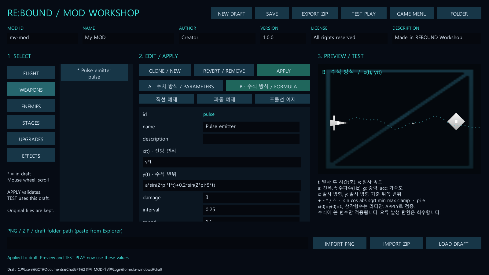

# 탄환 제작 두 가지 버전 — RE:BOUND 1.2

같은 Windows 게임에서 **A: 수치 방식**과 **B: 수식 방식**을 선택합니다. 프로젝트와 실행 파일은 하나이며, A/B 비교용 MOD ZIP을 각각 제공합니다. 두 구현은 같은 투사체 풀·피해 판정·발사 조건을 공유합니다.

| 항목 | A · 수치 방식 | B · 수식 방식 |
|---|---|---|
| 제작 방법 | 직선/파동/포물선/유도 선택 후 수치 조절 | 시간에 대한 `x(t)`, `y(t)` 직접 입력 |
| 파동 예 | speed 17, amplitude 0.6, frequency 2 | `x=v*t`, `y=a*sin(2*pi*f*t)` |
| 장점 | 수식 없이 쉽게 조절, 표적 유도 지원 | 여러 파동 합성, 시간별 이동 등 직접 설계 |
| 저장 필드 | `motionMode: parameters` | `motionMode: formula`, `formulaX`, `formulaY` |
| 샘플 MOD | `trajectory-a-parameters.zip` | `trajectory-b-formula.zip` |

## 바로 비교하기

1. `Builds/FullWindows/REBOUND.exe` 실행 → **MOD MANAGER → INSTALL SAMPLES**.
2. 기존에 같은 기체/무기를 바꾸는 MOD는 DISABLE합니다.
3. **A - 수치 탄환**을 ENABLE → BACK → START MISSION → LAUNCH.
4. 메뉴로 돌아와 A를 DISABLE하고 **B - 수식 탄환**을 ENABLE → 새 게임.

A와 B는 같은 `pulse` 무기를 교체하므로 동시에 켜면 충돌로 거부됩니다. 비교 샘플은 속도·진폭·주파수·공격력·발사 간격이 동일합니다. 동일 발사 위치와 방향이라면 파동 궤적이 일치해야 합니다. 일반 플레이에서는 자동 조준 대상이나 적 생성 위치가 달라지므로 화면 전체가 똑같이 재현되는 것은 아닙니다.

ZIP 원본은 `Assets/StreamingAssets/SampleMods/`, 편집 가능한 JSON은 `SampleMods/trajectory-a-parameters/` 및 `SampleMods/trajectory-b-formula/`에 있습니다. 모든 리소스가 별도 복제된 게임 두 개를 만드는 구조는 아닙니다.

## 제작 화면 사용

**MOD WORKSHOP → WEAPONS → 무기 선택** 후 가운데 위의 **A · 수치 방식 / PARAMETERS** 또는 **B · 수식 방식 / FORMULA**를 누릅니다.

- A에서는 기존 trajectory와 수치를 조절합니다.
- B에서는 x(t), y(t)를 편집합니다. 직선·파동·포물선 예제 버튼도 있습니다.
- `APPLY`로 수식과 데이터를 검증하고 미리보기를 갱신합니다.
- `SAVE` → `TEST PLAY`로 실제 탄환을 확인하거나 `EXPORT ZIP`으로 내보냅니다.
- 두 모드를 전환해도 각각의 수치/수식은 보존됩니다. 최종 저장된 mode가 실제 전투에 적용됩니다.

## 수식의 의미

`t`는 탄환이 발사된 뒤 흐른 초입니다. 수식 결과는 **발사점에서 얼마나 이동했는지**를 나타내는 위치 변위이며, 프레임마다 더하는 이동량이나 속도가 아닙니다.

- x(t): 처음 발사한 방향의 변위, 단위 units.
- y(t): 처음 발사한 방향에서 90도 반시계 방향의 변위. 오른쪽으로 쏘면 양수가 위쪽입니다.
- 발사각·자동 조준·fan 분산은 먼저 발사 방향을 정하며 수식 전체가 그 방향으로 회전합니다.
- x(0), y(0)는 모두 0이어야 합니다. 시작하자마자 순간이동하는 수식은 거부합니다.
- `v`: 실제 초기 발사 속도. 탄환 속도 능력치가 바뀌면 반영됩니다.
- `a`: amplitude 진폭, `f`: frequency 주파수, `g`: gravity 중력, `acc`: acceleration 가속도.
- `pi`, `e`: 수학 상수. 삼각함수 입력은 라디안입니다.
- 지원 연산: `+ - * / ^`, 괄호. `^`는 오른쪽부터 계산하며 `-2^2`는 -4입니다.
- 지원 함수: `sin(x)`, `cos(x)`, `abs(x)`, `sqrt(x)`, `min(x,y)`, `max(x,y)`, `clamp(x,min,max)`.
- 소수점은 `.`을 사용합니다. `2t` 대신 `2*t`를 씁니다. `1e-2` 같은 과학적 표기도 지원합니다.

**수식에 직접 사용한 변수만 작용합니다.** 예를 들어 `x=10*t`이면 speed를 바꿔도 항상 10 units/s이며, `x=v*t`이면 speed를 따릅니다. `g`를 사용하지 않는 수식에 중력 수치가 자동으로 더해지지 않습니다. 발사 간격·공격력·탄환 수·이미지·수명은 두 방식에서 공통으로 적용됩니다.

## 복사해서 쓸 수 있는 예제

| 궤적 | x(t) | y(t) |
|---|---|---|
| 직선 | `v*t` | `0` |
| 파동 | `v*t` | `a*sin(2*pi*f*t)` |
| 두 파동 합성 | `v*t` | `a*sin(2*pi*f*t)+0.2*sin(2*pi*5*t)` |
| 포물선 | `v*t` | `-0.5*g*t^2` |
| 전방 가속 | `v*t+0.5*acc*t^2` | `0` |
| 점차 커지는 파동 | `v*t` | `min(t,1)*a*sin(2*pi*f*t)` |

포물선은 g=6처럼 0이 아닌 값을 사용합니다. B의 포물선은 해석식 위치를 계산하고 A의 포물선은 기존 물리 적분을 유지하므로 약간의 수치 차이가 있습니다. A의 중력은 월드 아래쪽, B의 g 예제는 발사 방향 기준 아래쪽입니다. 수식 방식은 적의 좌표를 변수로 제공하지 않으므로 기존 homing과 같은 실시간 표적 추적은 A에서 사용합니다.

## 오류 처리와 현재 범위

수식은 C#이나 스크립트 실행 기능이 없는 산술 파서로 처리합니다. 축당 256자, 96개 값/연산 노드, 중첩 20단계로 제한합니다. 구문 오류, 알 수 없는 이름, 시작점 오류, 수명 내 샘플 검사에서 발견한 0 나누기·음수 제곱근·유한하지 않은 값·축별 절대 변위 10,000 초과는 APPLY/설치에서 거부합니다. 저장에 실패해도 마지막 정상 초안은 유지됩니다.

검증은 시작점과 수명 구간의 256개 샘플이며 모든 실수 시점의 연속성을 수학적으로 증명하는 것은 아닙니다. 실제 이동에서도 결과를 검사하고 잘못된 값을 만든 탄환은 피해 판정 전에 풀로 반환합니다. 충돌은 고정 물리 프레임 사이의 선분으로 검사하므로 매우 빠른 진동·불연속 궤적을 정밀한 연속 곡선 충돌로 처리하지는 않습니다.

v1.0/v1.1 MOD는 누락된 motionMode를 parameters로 읽습니다. 수식 초안을 저장할 때 targetGameVersion을 1.2.0으로 올려 구버전 게임이 수식 MOD를 조용히 무시하고 실행하지 않게 합니다. 화면 밖과 수명 종료의 기존 회수 규칙은 B에도 동일합니다.

## 주요 변경 파일

- `ContentData.cs`: mode와 x/y 수식 데이터.
- `TrajectoryFormula.cs`: 제한된 산술 파서·계산·검증·컴파일 결과 캐시.
- `ProjectileMotion.cs`, `CombatWorld.cs`: 공통 궤적 계산과 잘못된 탄환 회수.
- `ModWorkshop.cs`: A/B 선택, 수식 입력·예제·미리보기·오류 안내.
- `Modding.cs`, `WorkshopProject.cs`: 수식 검증과 1.2 버전 선언.
- `FullGameBuilder.cs`, `SampleMods/trajectory-*`: 두 비교 샘플 생성과 Windows 빌드.
- `TrajectoryFormulaTests.cs`, `FullGameTests.cs`, `WorkshopSmoke.cs`: 데이터/게임/Windows 검증.

EditMode 22개, PlayMode 23개 및 Windows 자동 검사가 통과했습니다. 상세 결과는 저장소의 `VALIDATION.md`에 있습니다. v1.1 제작 영상은 보존했으며 이번 수식 기능의 새 영상은 촬영하지 않았습니다.
