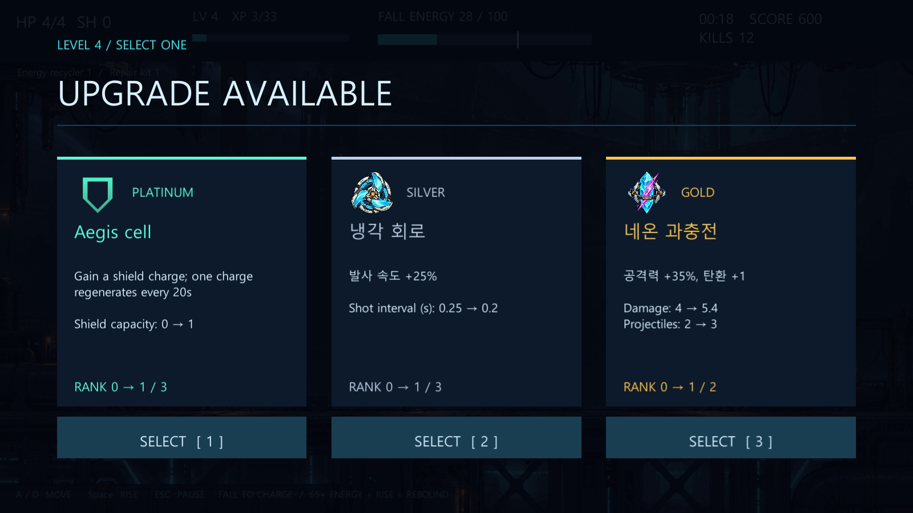

# MOD 제작부터 설치 플레이까지

최종 파일은 프로젝트의 `Videos/`에 제공합니다.

- `REBOUND-MOD-Workshop-KO.mp4`: 한국어 자막을 넣은 1920×1080, 30fps 영상. 게임 영역은 원본 1600×900이며 자막을 아래 별도 영역에 배치합니다.
- `REBOUND-MOD-Workshop-KO.srt`: 같은 영상의 별도 자막.
- `neon-wave-lab.zip`: 영상에서 실제로 제작·내보내기·설치한 MOD.
- 제작에 사용한 PNG와 이미지 생성 프롬프트: `DemoAssets/NeonWave/`.

기본 플레이 → MOD 정보 입력 → 플레이어·배경·적 4종 PNG 가져오기 → 탄환 이미지·파동 궤적 편집 → 처치 이펙트 → 기존 증강의 이미지·이름·설명·수치 수정 → 새 복합 증강과 전용 아이콘 제작 → 초안 시험 → ZIP 내보내기·설치·활성화 → 실제 설치된 MOD로 플레이 순서입니다.

기존 `haste`는 **냉각 회로 / 발사 속도 +25% / 최대 3단계**로 수정합니다. 새 `neon_core`는 **네온 과충전 / 공격력 +35%, 탄환 +1 / 골드 / 최대 2단계**입니다. 사용자 아이콘은 원래 색을 유지하고 등급 색은 카드 상단과 등급/이름에 표시합니다. 자유 설명 문구와 실제 계산된 전후 능력치를 함께 보여 줍니다.

## 완성 영상 구간

전체 **10분 05.5초**, 18,165프레임입니다. 증강 이미지·문구 수정을 반영해 처음부터 새로 녹화한 take02를 사용했습니다.

| 시작 | 내용 |
|---|---|
| 00:00 | 기본 게임 플레이 |
| 00:48 | 새 MOD 정보 입력 |
| 01:06 | 플레이어·배경·적 4종 이미지 교체 |
| 01:55 | 탄환 이미지와 파동 궤적 |
| 02:28 | 처치 이펙트 제작 |
| 02:48 | 기존 증강 이미지·이름·설명·수치 수정 |
| 03:12 | 새 복합 증강 ‘네온 과충전’과 아이콘 제작 |
| 04:12 | 저장·초안 시험 플레이 |
| 04:46 | ZIP 내보내기·설치·활성화 |
| 05:10 | 설치한 MOD로 전투·레벨업·Retry |
| 10:00 | 제작 결과 |

최종 실행 결과: 설치 MOD `neon-wave-lab`, 초안 오버라이드 **꺼짐**, 마지막 런 처치 57 / 레벨 9 / 네온 과충전 1단계 / 파동 탄환 3발 / 공격력 7.4. 앞선 런에서는 2단계 선택 시 공격력 5.4→6.8, 탄환 3→4를 확인했으며 이후 정상 피격으로 게임이 종료되어 Retry했습니다. HP를 유지시키거나 실패 장면을 제거하지 않았습니다.

검증 기록은 `Docs/TestResults/workshop-video-complete.json`, `workshop-video-evidence.txt`와 PlayMode 테스트 결과에 보관합니다.

최종 MP4 전체 디코딩 오류 0, 실제 오디오 RMS 0.01245 / peak 0.29011, 자막 79개, 챕터 11개를 확인했습니다. PNG 10개의 해시가 내보낸 ZIP과 제작 원본에서 일치했고 한글 증강 이름·설명도 ZIP에서 다시 읽어 확인했습니다. 미디어 규격과 SHA-256은 `Docs/TestResults/workshop-video-media.json`에 있습니다.



새 증강의 weight 100은 같은 등급 내의 선택 가중치입니다. 골드 등급 자체의 출현 확률을 강제로 변경하지 않습니다. 최종 플레이에서 실제 후보로 등장한 증강을 선택합니다.

## 실제 녹화 방식

`WorkshopRecorder`를 명시적 `--workshop-video` 옵션으로 실행했습니다. Unity의 실제 카메라·Canvas·게임 오디오를 매 프레임 캡처합니다. UI 버튼 콜백과 입력 필드를 자동 조작하고, 플레이는 일반 이동 입력과 상승 동작을 호출합니다. 수동 마우스 플레이를 촬영한 것으로 표시하지 않습니다.

HP·경험치·적·피해량·게임 경과 시간을 녹화 도구가 직접 조작하지 않습니다. `Time.captureFramerate=30`으로 프레임을 저장하며 실제 플레이 속도로 재생합니다. 레벨업 중 게임 시간 정지, 정상 피격, 처치, 반동, 재시도는 게임 로직을 따릅니다. 최고 기록 저장만 끄고 별도의 설정/MOD/초안 폴더를 사용합니다. ZIP을 Inbox에 복사하는 단계는 녹화 도구가 수행하며 자막에도 명시합니다.

## 재현

1. Unity 메뉴 **REBOUND → Build Full Windows Game**으로 빌드합니다.
2. Windows 실행 파일에 다음 옵션을 지정합니다. 출력 폴더는 새 빈 경로를 사용합니다.

```powershell
$root = (Get-Location).Path
& "$root\Builds\FullWindows\REBOUND.exe" `
  --workshop-video `
  --video-output "$root\Logs\workshop-video-new" `
  --demo-art "$root\DemoAssets\NeonWave" `
  --ffmpeg 'C:\path\ffmpeg.exe'
```

3. `complete.json`이 생성되고 `error.txt`가 없는지 확인합니다. `evidence.txt`에 설치된 MOD, 초안 오버라이드 해제, 실제 처치/레벨/새 증강 단계가 기록됩니다.
4. 자막·챕터·실제 게임 오디오를 합칩니다.

```powershell
python Tools/finish_workshop_video.py Logs/workshop-video-new --ffmpeg C:/path/ffmpeg.exe
```

FFmpeg는 libx264, AAC, libass 지원이 필요하며 한국어 자막에는 Windows 맑은 고딕을 사용합니다. 인코더와 폰트 파일 자체를 게임에 포함하지 않습니다. 중간 캡처는 Git에서 제외된 Logs에 보관하고 최종 영상만 Videos와 GitHub Release에 제공합니다.

## 같은 MOD를 플레이하거나 수정하기

게임 → MOD MANAGER → OPEN MOD FOLDER → Inbox에 `neon-wave-lab.zip` 복사 → INSTALL INBOX ZIPs → ENABLE → 새 게임 시작.

다른 MOD가 같은 기체나 무기를 교체한다면 먼저 그 MOD를 DISABLE합니다. 설치된 폴더를 직접 덮어쓰지 말고 Workshop의 IMPORT ZIP으로 별도 초안을 가져와 수정하세요. UI는 영문이며 사용자 이름·설명과 이번 영상 자막은 한글을 지원합니다.
