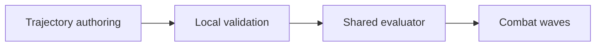

# RE:BOUND

[English](README.md) · [Korean](README.ko.md) · [Japanese](README.ja.md)

**C# · Unity 2D · Local content** · プレイ可能なプロトタイプ

[開発事例を見る](https://ysl-ryudo.github.io/ja/work/rebound/) · [Portfolio](https://ysl-ryudo.github.io/ja/)

ローカルのデータ駆動MODワークショップを備えたUnity 2D重力ローグライクシューティングです。

## 取り組んだ課題

重力シューティングと制作ツールで、作成した軌道を同じように解釈する必要があります。ローカルコンテンツはゲームへの反映前に検証します。

## 担当した実装と設計

落下で充電・上昇で攻撃するループと、軌道・敵・ウェーブ・強化の制作ツールを実装しました。パラメーター・数式軌道の評価器をゲームとツールで共有し、ローカルZIPを検証します。

### 実装概要 · 概念フロー

## 担当した内容

- 落下による充電・上昇攻撃、戦闘ウェーブ、強化選択、ボス進行、設定保存を実装しました。
- ローカルZIP MODの検証と、弾道・敵・ウェーブ・強化の制作ツールを実装しました。
- パラメーター・数式による弾道編集と、ゲーム・制作ツール共通の弾道評価を追加しました。

## 貢献の根拠

- [v1.2 source baseline](https://github.com/YSL-RyuDo/rebound/tree/6fbc48dfb088b5d7a6fef3d45694d976b95d3721)

コミットは記載した変更の根拠であり、貢献率の点数ではありません。外部素材・チームメンバーの貢献は区別します。

## 実行・コードの確認

[ProjectVersion.txt](ProjectSettings/ProjectVersion.txt)記載のUnity版で開いてください。パッケージロックとシリアライズ済み素材を維持し、Unityを開く前に対象ブランチを選んでください。

- Unity scene: [Assets/Rebound/Scenes/REBOUND.unity](Assets/Rebound/Scenes/REBOUND.unity)

## 開発・検証範囲

2026-10-19の記録ではEditMode 22件・PlayMode 23件成功とWindowsビルドを確認しています。本README作業での再実行結果ではありません。遠隔MODサービスは未接続で、長時間の手動バランス・アクセシビリティ検証や極端な弾道の連続衝突は検証範囲外です。

## 詳細資料

- [既存の詳細開発・利用・検証資料（韓国語）](docs/DEVELOPMENT_REFERENCE.ko.md)
- [VALIDATION.md](VALIDATION.md)
- [Docs/WORKSHOP_GUIDE.md](Docs/WORKSHOP_GUIDE.md)
- [Docs/TRAJECTORY_VERSIONS.md](Docs/TRAJECTORY_VERSIONS.md)
- [Docs/RESOURCES.md](Docs/RESOURCES.md)

## 実装の確認方法

2026-10-19の記録にはEditMode 22件・PlayMode 23件の成功とWindowsビルドがあります。既存記録であり、バランスや極端な軌道の衝突には別途評価が必要です。
