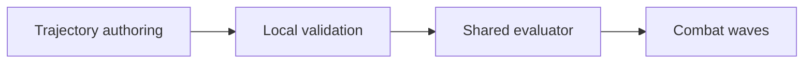

# RE:BOUND

[English](README.md) · [Korean](README.ko.md) · [Japanese](README.ja.md)

**C# · Unity 2D · Local content** · Playable prototype

[Explore the case](https://ysl-ryudo.github.io/en/work/rebound/) · [Portfolio](https://ysl-ryudo.github.io/en/)

An original Unity 2D gravity roguelike shooter with a local data-driven MOD workshop.

## The engineering problem

A gravity shooter and its content workshop need to interpret authored trajectories consistently. Local content also needs validation before it affects gameplay.

## My implementation

I built the fall-to-recharge/ascent-attack loop and a workshop for trajectories, enemies, waves and augments. Parameter/formula trajectory authoring shares its evaluator with the game, alongside local ZIP validation.

### Implementation overview · conceptual flow

## My contribution

- Implemented the fall-to-recharge/ascent-attack loop, combat waves, upgrades, boss progression and persistent settings.
- Built local ZIP MOD validation and a workshop for projectile trajectories, enemies, waves and augments.
- Added parameter/formula trajectory authoring and shared trajectory evaluation between the game and its workshop.

## Contribution evidence

- [v1.2 source baseline](https://github.com/YSL-RyuDo/rebound/tree/6fbc48dfb088b5d7a6fef3d45694d976b95d3721)

Commits are evidence of the stated changes, not a percentage-of-authorship score. Third-party assets and teammates' work remain separately credited.

## Open and inspect

Open the project with the Unity version recorded in [ProjectVersion.txt](ProjectSettings/ProjectVersion.txt). Keep its package lock and serialized assets intact. Select the documented branch before opening Unity.

- Unity scene: [Assets/Rebound/Scenes/REBOUND.unity](Assets/Rebound/Scenes/REBOUND.unity)

## Development and verification scope

The 2026-10-19 validation record reports 22 EditMode and 23 PlayMode tests passing and a Windows build. These are historical recorded checks, not tests rerun for this README. Remote MOD service integration is not connected. Long manual balance/accessibility testing and continuous collision for extreme trajectories remain outside the verified scope.

## Further documentation

- [Existing detailed development reference (Korean)](docs/DEVELOPMENT_REFERENCE.ko.md)
- [VALIDATION.md](VALIDATION.md)
- [Docs/WORKSHOP_GUIDE.md](Docs/WORKSHOP_GUIDE.md)
- [Docs/TRAJECTORY_VERSIONS.md](Docs/TRAJECTORY_VERSIONS.md)
- [Docs/RESOURCES.md](Docs/RESOURCES.md)

## How to evaluate the work

The 2026-10-19 record reports 22 EditMode and 23 PlayMode passes and a Windows build. This is an existing record; balance and extreme-trajectory collision still need separate evaluation.
