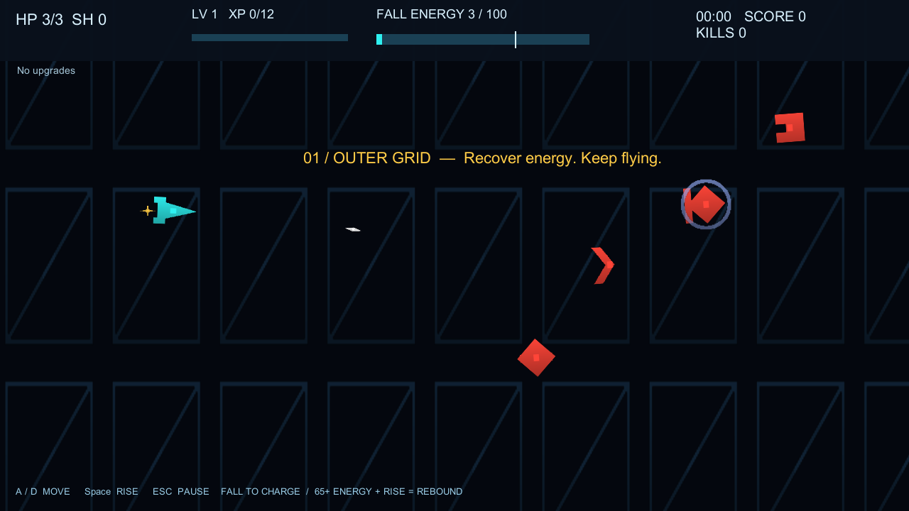

# RE:BOUND

Windows용 오리지널 2D 중력 로그라이크 슈팅 게임. 하강으로 에너지를 회수하고 상승하면서 전방 반동 공격을 사용합니다.

- Unity **2022.3.62f3 LTS**, Built-in 2D, C#.
- Input Manager (Old), `Unity UI` Canvas Scaler 기준 **1920×1080**.
- 4종 일반 적, 13종 기본 업그레이드, 4분 뒤 등장하는 3페이즈 GRAVITY WARDEN.
- 경험치 자동 지급, 중복 없는 가중치 3지선다, 연속 레벨업 큐, 일시정지·재시작.
- 로컬 ZIP MOD 설치·검증·활성화·해제, 샘플 2종.
- 직접 만든 절차적 기체 그래픽·이펙트·효과음·4개 음악 루프.
- 설정·키 매핑·기록·활성 MOD 저장.

## 바로 실행

Windows 빌드: `Builds/FullWindows/REBOUND.exe`.

실행 파일만 옮기지 말고 **FullWindows 폴더 전체**를 복사하세요. GitHub Release의 Windows ZIP도 같은 구조입니다. 소스 저장소에는 Unity 캐시와 실행 파일을 넣지 않습니다.

Unity 실행 순서:

1. Unity Hub에서 이 프로젝트 폴더를 추가합니다.
2. **2022.3.62f3**로 열고 패키지 임포트가 끝날 때까지 기다립니다.
3. **REBOUND → Open Full Game**을 선택합니다. 시작 씬은 `Assets/Rebound/Scenes/REBOUND.unity`입니다.
4. Play 후 Game 뷰를 클릭합니다. **START MISSION → LAUNCH**로 시작합니다.
5. Windows 빌드는 **REBOUND → Build Full Windows Game**으로 생성합니다.

`Assets/Rebound/Scenes/Game.unity`와 기존 Runtime 폴더는 이전 Phase 1 회귀 테스트용으로 보존했습니다. 전체 게임의 시작 씬과 코드는 `REBOUND.unity` 및 `Assets/Rebound/Full/`입니다.

## 조작과 게임 진행

| 입력 | 동작 |
|---|---|
| A / D | 화면 왼쪽 40% 영역 안에서 좌우 이동 |
| Space | 한 번 누를 때 상승. 기본 입력 간격 0.25초 |
| Esc | 일시정지 / 재개 |
| 1 / 2 / 3 | 레벨업 카드 선택 |
| 마우스 | 메뉴·설정·MOD·카드·결과 버튼 |

기본 중력 6, 상승 속도 4.8, 이동 속도 5, 최대 낙하 속도 6, HP 3입니다. 실제 하강 거리와 하강 속도에 따라 에너지를 충전하며, **65 이상일 때 상승하면 반동 공격**이 발동합니다. 충전되지 않아도 상승할 수 있습니다. 반동은 전방 범위 피해, 연쇄 업그레이드, 적 탄환 제거를 지원합니다.

무기는 자동 발사하며 전방 ±20도 안의 가장 가까운 적을 조준합니다. 적을 처치하면 경험치가 자동 지급됩니다. 업그레이드 선택 중에는 게임 시간이 멈춥니다. 추락하면 HP 1을 잃고 안전 위치로 돌아오며, 일반 피격 뒤에는 1.2초 무적입니다.

스테이지는 0–30초 정찰, 30–90초 추적, 90–150초 차폐, 150–210초 포격, 210–240초 강화 웨이브로 진행합니다. 240초 뒤 보스가 등장하며 HP 60%·25%에서 공격이 바뀝니다. 5분은 목표 시간이며 강제 종료하지 않습니다. 보스를 처치해야 승리합니다.

## MOD 사용

1. 메인 메뉴 → **MOD MANAGER**.
2. **INSTALL SAMPLES**로 LIGHT FRAME과 OVERCHARGE ZIP을 설치합니다.
3. 원하는 패키지에 **ENABLE**을 누르고 메뉴로 돌아가 새 게임을 시작합니다.
4. 사용자 ZIP은 **OPEN MOD FOLDER → Inbox**에 넣고 **INSTALL INBOX ZIPs**를 누릅니다.
5. **DISABLE** 후 새 게임을 시작하면 해당 변경이 해제됩니다.

두 샘플은 모두 기본 `re01` 기체를 교체하므로 **한 번에 하나만 활성화**하세요. 동시에 켜면 modId 정렬상 뒤에 오는 충돌 패키지를 거부하고 화면에 오류를 표시합니다. 기본 게임은 계속 실행됩니다. 샘플 소스는 `SampleMods/`, 설치 ZIP은 `Assets/StreamingAssets/SampleMods/`에 있습니다.

MOD와 설정은 `Application.persistentDataPath`에 저장됩니다. Windows 기본 위치는 `%USERPROFILE%/AppData/LocalLow/Independent Prototype/REBOUND/`입니다. MOD Manager의 폴더 열기를 사용하면 실제 위치로 바로 이동합니다.

## 코드 및 데이터

| 파일 / 경로 | 역할 |
|---|---|
| `Assets/Rebound/Full/GameSession.cs` | 시작·상태 전환·런 초기화·승패·콘텐츠 연결 |
| `ContentData.cs` | 콘텐츠 DTO, 기본 콘텐츠 작성기, 레지스트리 |
| `PlayerFlight.cs` | Update 입력, FixedUpdate 이동·낙하·추진·에너지·HP·무적 |
| `CombatWorld.cs` | 적·투사체 풀·연속 선분 충돌·자동 조준·피해·반동·웨이브·보스 |
| `Progression.cs` | 경험치·레벨 큐·후보 추첨·13종 효과·원본 기반 능력치 재계산 |
| `Modding.cs` | ZIP 설치·경로/크기/데이터 검증·원자적 콘텐츠 적용·PNG/WAV 로딩·서버 인터페이스 |
| `GameUI.cs` | Canvas 메뉴·스토리·HUD·설정·일시정지·카드·결과·MOD·크레딧 |
| `SaveManager.cs` | 버전 있는 JSON 설정 저장·손상 복구·키 매핑 |
| `ArtFactory.cs` | 자체 생성 스프라이트·시각 효과·MOD 스킨 |
| `AudioDirector.cs` | 직접 합성한 효과음·4개 음악 루프·볼륨·MOD 오디오 |
| `ReleaseSmoke.cs` | 명시적인 CLI 옵션에서만 실행되는 Windows 통합 검증 |
| `Assets/Rebound/Resources/base-content.json` | 실제 게임에서 읽는 기본 콘텐츠·스토리 데이터 |
| `Assets/Editor/FullGameBuilder.cs` | 시작 씬·기본 JSON·샘플 ZIP 생성, Windows 빌드 |
| `Assets/Rebound/Tests/PlayMode/FullGameTests.cs` | 전체 게임 및 MOD 회귀 테스트 |

데이터 수정은 `base-content.json`에서 합니다. `BuiltinContent.Create()`는 초기 생성용이며, 생성기는 기존 JSON과 씬을 덮어쓰지 않습니다. 씬은 GameBootstrap이 런타임에 월드·Canvas·EventSystem·오디오·풀을 구성하므로 수동 오브젝트 연결은 필요 없습니다.

## 문서

- `Docs/FULL_GAME_SPEC.md`: 전달받은 전체 요구사항 원문.
- `Docs/MOD_GUIDE.md`: 스키마, 교체 규칙, 제한, 제작 예시.
- `Docs/SERVER_INTEGRATION.md`: 서버 연결을 위해 필요한 실제 정보.
- `Docs/RESOURCES.md`: 그래픽·사운드·패키지 및 라이선스 출처.
- `VALIDATION.md`: 실제 실행한 테스트 및 남은 확인 항목.
- `Docs/PHASE1_README.md`, `Docs/PHASE1_VALIDATION.md`: 이전 버전 기록.

현재 UI와 스토리는 영문입니다. 오디오는 절차적으로 합성한 짧은 루프이며 전문 제작 음악은 아닙니다. 서버 API가 제공되지 않아 원격 검색·다운로드는 연결하지 않았고, 로컬 ZIP 설치는 구현했습니다. 실제 출시 품질을 위한 장시간 수동 밸런스·접근성·다양한 PC 검증은 별도입니다.
